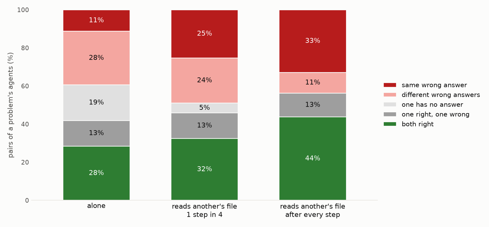

# Groupthink: How should agents communicate?

*In the post: the case study of the same name, and its Figure 2, "Peer-reading experiment". One section of the
[Agent Management Science results](../README.md); every path and command below is from this folder,
`groupthink/`.*

The logs, result tables and code behind the case study. Eight agents, all one model, work on the same math
problem, each in a Python file of its own, for at most 20 steps. One rule changes: how often an agent is shown the
file of a randomly picked peer. They do this on the first 25 problems of MathArena's Apex Shortlist. The model is
Qwen3.5-9B, run from Qwen's own weights on a rented H100.

## Headline

| share of agent pairs | without peer reading | with peer reading (a peer's file after every step) |
|---|---|---|
| gave the same wrong answer | **11.3%** (79 of 700) | **32.9%** (230 of 700) |
| gave the same right answer | **28.4%** (199 of 700) | **43.7%** (306 of 700) |

The more often agents read, the more pairs end on one answer, the right one or a wrong one. In between, with a
peer's file after 1 step in 4, the two rows are 25.3% and 32.4%.

**The three reading rules**

- **No peer reading.** Each agent works alone.
- **A peer's file after 1 step in 4.** After each of its steps from the second, an agent is picked with a chance
  of 1 in 4 to read the file of one of the other seven, drawn at random. It is shown that file and what Python
  printed when the file last ran, and says what it makes of it. That is an extra turn, not one of its 20 steps.
  The other agent is shown those words after its next step.
- **A peer's file after every step.** The same, after every step from the second.

A reader is not told how many agents hold an answer, or whether any answer is right.

**What the number means.** A pair is two of the eight agents on one problem under one rule. A problem has 28
pairs, and the 25 problems have 700. A percent is of a problem's pairs, averaged over the problems.

- **An agent's answer** is the last `ANSWER:` line its file printed in a run without errors, as it stood when the
  agent handed in or ran out of steps.
- **Right** means a checker (math-verify) found the answer equal to MathArena's. No person read the answers.
- **The same wrong answer** means the two wrong answers are written the same, after tidying. `n^2` and `n**2`
  count as two different wrong answers, so the row can miss pairs that agree.
- **A pair in which one or both agents have no answer** is in neither row.
- **"With peer reading"** is a peer's file after every step, the most reading of the three.

**How to read a cell.** One run, with one seed. The same eight agents play a problem under all three rules: the
random draws are fixed by the problem, the agent and the step, so under a reading rule an agent gives the replies
it gives alone until it first reads a file or is first shown another agent's words. Such a reply is marked
`cached` in the transcripts.

**What it does not show.**

- **Whether the reading or the extra turns did it.** Reading a file is an extra turn. No control was run in which
  agents pause as often and read only their own file. So the rise is reading and its extra turns together.
- **One run.** One seed and eight agents a problem. An agent is in seven pairs, so the 700 pairs are not 700
  separate counts. The unit is the problem, and there are 25 of them.
- **A few problems carry it.** With a peer's file after every step, the pairs on the same wrong answer rose on 11
  problems, stayed on 10 and fell on 4. The six largest rises are 17.4 of the 21.6 points.
- **Part of the rise is agents who end with no answer alone.** Alone, 23 of the 200 agents end with none. With a
  peer's file after every step all 200 end with one, and pairs with a missing answer go from 18.7% to none.
- **One model, and 25 of the set's 47 problems**: the first 25 by MathArena's numbering.
- **Not MathArena's score for this model.** These agents work in a Python file for 20 steps, and this code's
  checker scores them.
- **Why.** The tables count answers. They do not say what a reader took from a file.

## By how often an agent reads

| 25 problems, 8 agents a problem | no peer reading | a peer's file after 1 step in 4 | a peer's file after every step |
|---|---|---|---|
| after one of its steps, an agent reads a peer's file | never | with a chance of 1 in 4 | every time |
| files read, by how many of the agents | none | 467, by 172 | 1,497, by 200 |
| **pairs: both right** | 28.4% (199) | 32.4% (227) | 43.7% (306) |
| **pairs: the same wrong answer** | 11.3% (79) | 25.3% (177) | 32.9% (230) |
| pairs: two different wrong answers | 28.1% (197) | 23.7% (166) | 10.9% (76) |
| pairs: one right, one wrong | 13.4% (94) | 13.4% (94) | 12.6% (88) |
| pairs: one or both with no answer | 18.7% (131) | 5.1% (36) | 0.0% (0) |
| agents that ended right | 37.5% (75) | 40.0% (80) | 50.0% (100) |
| agents that ended on a wrong answer | 51.0% (102) | 57.0% (114) | 50.0% (100) |
| agents that ended with no answer | 11.5% (23) | 3.0% (6) | 0.0% (0) |

A percent of pairs is of a problem's 28 pairs, averaged over the 25 problems, and the count beside it is of all
700 pairs. A percent of agents is of a problem's 8 agents, averaged over the problems, and the count is of all 200
agents.



The figure is the one the code drew for the run (`runs/main/pairs.png`). Its "alone" is no peer reading.

## Against no peer reading, problem by problem

The same eight agents play a problem under every rule, so each rule with reading is held against no reading one
problem at a time.

| the rise in a problem's pairs, in points | a peer's file after 1 step in 4 | a peer's file after every step |
|---|---|---|
| pairs: the same wrong answer | +14.0 (+5.6 to +23.9) | +21.6 (+9.3 to +34.9) |
| pairs: both right | +4.0 (+0.1 to +8.3) | +15.3 (+5.0 to +27.1) |
| problems on which the pairs on the same wrong answer rose, stayed, fell | 13, 10, 2 | 11, 10, 4 |

In brackets, a 95% interval over the 25 problems (the problems drawn again with replacement, 10,000 times).

## Problem by problem

For each problem, three numbers in the order of the columns above: no peer reading, a peer's file after 1 step in
4, a peer's file after every step.

| problem | known answer | agents right, of 8 | pairs on the same wrong answer, of 28 | agents on the most-held wrong answer |
|---|---|---|---|---|
| 1 | `171` | 0, 0, 0 | 4, 10, 11 | 3, 5, 5 |
| 2 | `89` | 0, 3, 6 | 0, 0, 0 | 1, 1, 1 |
| 3 | `63` | 8, 8, 8 | 0, 0, 0 | 0, 0, 0 |
| 4 | `2618` | 8, 8, 8 | 0, 0, 0 | 0, 0, 0 |
| 5 | `8096` | 3, 3, 0 | 1, 3, 16 | 2, 3, 6 |
| 6 | `2077992225` | 0, 0, 0 | 10, 6, 28 | 5, 4, 8 |
| 7 | `1030219` | 2, 4, 7 | 0, 0, 0 | 1, 1, 1 |
| 8 | `n-1` | 2, 0, 3 | 1, 8, 1 | 2, 4, 2 |
| 9 | `2^{20} - 1` | 7, 8, 8 | 0, 0, 0 | 1, 0, 0 |
| 10 | `59` | 0, 0, 0 | 6, 28, 28 | 4, 8, 8 |
| 11 | `325` | 1, 0, 0 | 1, 21, 28 | 2, 7, 8 |
| 12 | `n(n-1)/2` | 6, 5, 4 | 0, 0, 3 | 1, 1, 3 |
| 13 | `2^{21} - 2` | 2, 1, 0 | 3, 21, 28 | 3, 7, 8 |
| 14 | `2n(n-1)` | 0, 0, 0 | 3, 7, 11 | 3, 4, 5 |
| 15 | `505` | 4, 4, 8 | 0, 3, 0 | 1, 3, 0 |
| 16 | `495` | 0, 0, 0 | 3, 4, 13 | 3, 3, 5 |
| 17 | `4` | 0, 0, 0 | 13, 21, 28 | 5, 7, 8 |
| 18 | `24` | 8, 8, 8 | 0, 0, 0 | 0, 0, 0 |
| 19 | `74` | 8, 8, 8 | 0, 0, 0 | 0, 0, 0 |
| 20 | `1520` | 7, 8, 8 | 0, 0, 0 | 0, 0, 0 |
| 21 | `333400` | 0, 0, 5 | 6, 6, 1 | 3, 3, 2 |
| 22 | `12` | 0, 0, 0 | 15, 21, 28 | 6, 7, 8 |
| 23 | `2023` | 0, 0, 4 | 11, 15, 6 | 5, 6, 4 |
| 24 | `281` | 6, 7, 7 | 1, 0, 0 | 2, 1, 1 |
| 25 | `60` | 3, 5, 8 | 1, 3, 0 | 2, 3, 0 |

- **With a peer's file after every step, all eight agents end on one wrong answer on six problems**: 6, 10, 11,
  13, 17 and 22. Alone, at most six of the eight do, on problem 22.
- **Reading also carried right answers.** On problems 2, 21 and 23 nobody is right alone, and 6, 5 and 4 of the
  eight are with a peer's file after every step.
- **Problem 5 went the other way.** Three of the eight are right alone, on 8096. With a peer's file after every
  step nobody is, and six end on 4050.

## The run

| | |
|---|---|
| model | `Qwen/Qwen3.5-9B@c202236235762e1c871ad0ccb60c8ee5ba337b9a` |
| served by | vllm 0.31.0, as `9B-bf16`, on one NVIDIA H100 PCIe |
| started, finished | 2026-10-13 06:12:42, 2026-10-13 10:46:13 |
| problems | 1, 2, 3, 4, 5, 6, 7, 8, 9, 10, 11, 12, 13, 14, 15, 16, 17, 18, 19, 20, 21, 22, 23, 24, 25 of `apex_shortlist` |
| seed | 0 |
| agents a problem | 8 |
| steps an agent has | 20 |
| tokens of thought a step, at most | 1,024 |
| tokens of reply a step, at most | 5,760 |
| lines a file may have | 300 |
| how a reply is drawn | temperature 0.6, top-k 20, top-p 0.95 (a thought: temperature 1.0, presence penalty 1.5) |
| model calls | 2,613, 3,130, 4,228 |
| tokens the model wrote | 4,357,300, 4,592,226, 4,982,091 |
| commit of the code | `23266ab7188a`, with nothing uncommitted |

The three arms have the same settings but for who reads. Where a row has three numbers, they are in the order: no
peer reading, a peer's file after 1 step in 4, a peer's file after every step.

**What an agent has.** A Python file, `work.py`, and three tools: `write_file`, `edit_file` and `submit`. Python
runs the file each time a step changes it, in a sandbox with sympy and numpy, and the agent is shown what it
printed. An agent stops when it calls `submit` or has taken its 20 steps. What it is told, word for word, is
`system` under each arm in `runs/main/config.json`.

## What is in this folder

```
results/      the tables above, as files, and the script that rebuilds them from the logs
runs/main/    the logs of the run: every model call, every file an agent wrote, every look (90 MB)
code/         the code that ran it: the lab's package and experiment, and the engine that calls the model
```

### results/

| file | what it holds |
|---|---|
| `tables.md` | the tables above |
| `pairs.csv` | a reading rule a row: its pairs by how the two agents ended, as counts and as percents, how its agents ended, and how many files were read |
| `change.csv` | each rule with reading against no reading: the rise in pairs on the same wrong answer and in pairs both right, with its interval, and on how many problems it rose, stayed and fell |
| `problems.csv` | a problem under a reading rule a row: the known answer, how the eight ended, the 28 pairs by kind, and the most-held wrong answer |
| `answers.csv` | an agent a row: the answer it ended on, and whether that is right, wrong or no answer |
| `make_tables.py` | rebuilds all of the above from `runs/main/` |

Where each number in the post comes from:

| in the post | file |
|---|---|
| Figure 2, "Peer-reading experiment", and the last sentence of "Our experiment": pairs of agents gave the same wrong answer 33% of the time with peer reading, against 11% without it | `results/pairs.csv`: `pct_pairs_same_wrong`, 32.9 in the row `always_look_at_others` and 11.3 in the row `desk` |
| "More frequent peer reading increased convergence on both correct and incorrect answers" | `results/pairs.csv`, down its three rows: `pct_pairs_both_right` is 28.4, 32.4, 43.7 and `pct_pairs_same_wrong` is 11.3, 25.3, 32.9 |
| "teams of eight agents" | `results/pairs.csv`: `agents_a_problem`. In the logs, `agents` under each arm in `runs/main/config.json` |
| "the Qwen3.5-9B model" | `results/tables.md`, "The run". In the logs, `model` in `runs/main/engine.jsonl` |
| "25 MathArena problems", "the first 25 of MathArena's Apex Shortlist" | `results/problems.csv`: problems 1 to 25. In the logs, `--only 1 2 ... 25` in `command` in `runs/main/config.json`. The numbers are MathArena's own (`apex_shortlist` in `code/math_swarm_explore/mathswarm/benchmarks.py`) |
| "varying how often agents could read a randomly selected peer's work" | `results/pairs.csv`: `chance_of_reading_after_a_step` and `files_read`. The draw is `RandomLooks.plan` in `code/math_swarm_explore/mathswarm/looks.py`, and every look is a line of `runs/main/looks.jsonl` |

### runs/main/

The folder of the one run, as the code wrote it.

| file | what it holds |
|---|---|
| `config.json` | every setting of each arm, what an agent is told (`system`), the seed, the command, the commit of the code and the machine |
| `episodes.jsonl` | a problem under an arm a line: the known answer (`truth`) and the answer each agent held after each of its steps (`answers`: 20 lists of 8). The tables are built from the last list |
| `looks.jsonl` | a look a line: who read (`reader`) whose file (`of`) after which of its steps (`step`), what the reader held (`own`), what the file had printed (`printed`), and what the reader said (`said`). `seen` is null when the other agent had no file yet, and nothing was shown |
| `posts.jsonl` | a step of an agent a line: the tool it called, its file as it then stood (`python`), what Python printed (`check`), and the answer it held |
| `transcripts.<arm>.jsonl` | a model call a line: what the agent was shown (`prompt`), its thought, its reply, and what its tool calls did (`did`). A line with `look` is the extra turn of a look |
| `engine.jsonl` | a problem under an arm a line: the model and its revision, the server, the seed of every call, tokens and timings |
| `log.txt` | what the run printed as it went |
| `summary.json`, `summary.md` | the run's own tables, written when it ended. The pair measure was added to the code after that, so they do not have it |
| `pairs.png`, `steps.png`, each with a `.md` | the two figures the code drew for the run, and their captions |

**The transcripts are in three files, one for each arm.** The run wrote one file, `transcripts.jsonl`, of 68 MB,
and this repo keeps files under 50 MB. No line is changed. Joined in the order the arms ran, they are the file
the run wrote:

    cat runs/main/transcripts.desk.jsonl runs/main/transcripts.look_at_others.jsonl \
        runs/main/transcripts.always_look_at_others.jsonl | shasum -a 256
    5adf7fead08fb3de96b3c05ba9abd32d8a8b642c27a6a7931cc8b5da6c64e240

Every other file is byte for byte the run's.

The logs' words for things differ from the post's:

| the post says | the logs say |
|---|---|
| without peer reading | the arm `desk` |
| reading a peer's work after 1 step in 4 | the arm `look_at_others` |
| reading a peer's work after every step | the arm `always_look_at_others` |
| one reading of a peer's file | a look |
| MathArena's answer to a problem | `truth` |
| an agent's step | a `round`, counted from 0 |
| the eight agents | `agent` 0 to 7 (`log.txt` counts them from 1) |
| Qwen3.5-9B | `9B-bf16`: Qwen's own weights in bf16 |

**The problems are MathArena's.** Each agent's transcript opens with its problem, and the logs hold the answers.
Both are from [MathArena/apex-shortlist](https://huggingface.co/datasets/MathArena/apex-shortlist), which is
shared under CC BY-NC-SA 4.0. They stay under that license here: the MIT license of this repo covers the rest.

**Written by agents.** The logs hold Python that agents wrote. Read it, and run it only inside a sandbox.

### code/

```
code/math_swarm_explore/     the lab: the package mathswarm, the experiment, and what it needs installed
code/swarm_engine/           the engine that makes every model call
```

Two Python projects, side by side as they were on the machine that ran them: the lab installs the engine from the
folder beside it (`../swarm_engine` in its `pyproject.toml`).

| in `code/math_swarm_explore/` | what it holds |
|---|---|
| `mathswarm/harness.py`, `python.py`, `linux.py` | what an agent is told, its three tools, and the sandbox its file runs in |
| `mathswarm/looks.py` | the reading rule: who reads whose file after which step (`RandomLooks.plan`), and the words of a look |
| `mathswarm/swarm.py`, `reading.py` | a problem's eight agents at work together, and what counts as an agent's answer |
| `mathswarm/grading.py` | whether an answer is right |
| `mathswarm/metrics.py` | the measures. `pairs` is the one in the headline |
| `mathswarm/benchmarks.py`, `problems.py` | the problems, from `MathArena/apex-shortlist` at a pinned commit |
| `mathswarm/experiment.py`, `llm.py` | the settings of an arm, and the calls to the model, which go to the engine |
| the rest of `mathswarm/` | the command line (`cli.py`), a run's logs (`tracking.py`), its tables and figures (`report.py`, `figures.py`, `standings.py`), and renting the GPU (`cloud.py`, `packing.py`) |
| `experiments/apex_shortlist/experiment.py` | the three arms |
| `experiments/apex_shortlist/reproduce.sh` | the commands as they were handed in, with what they cost |
| `pyproject.toml`, `uv.lock`, `.python-version` | what the lab had installed |

| in `code/swarm_engine/` | what it holds |
|---|---|
| `swarm_engine/vllm.py`, `vllm_server.py` | the engine on a GPU: it starts a vLLM server for the model, and sends it every call with its seed |
| `swarm_engine/models.py`, `settings.py`, `common.py` | the models by name and revision, how a reply is drawn, and the seed of each call |
| `swarm_engine/cloud/` | renting a GPU for a job, bringing back what it made, and giving the GPU back |
| the rest of `swarm_engine/` | the engine on a Mac, through MLX (`engine.py`), which this run did not use; checks, and a stand-in for tests |
| `pyproject.toml`, `uv.lock` | what the engine needs installed |

**It is the code the run was made under.** The run's logs record a hash of the files that decide what an agent is
told and shown, and of the engine's. In `runs/main/config.json` they are `harness`, `contact` and `workshop` under
each arm, and `sandbox` under `machines`. In `runs/main/engine.jsonl` it is `source_sha256`. The files here give
the same five:

    cd code/math_swarm_explore/mathswarm
    cat harness.py python.py | shasum -a 256      # 634021f6f24b...  harness
    cat looks.py | shasum -a 256                  # 768650c15419...  contact
    cat swarm.py reading.py | shasum -a 256       # dd308df12225...  workshop
    cat linux.py | shasum -a 256                  # 86eca2e187d2...  sandbox
    cd ../../swarm_engine/swarm_engine
    cat vllm.py common.py settings.py | shasum -a 256      # 850d645939ac...  source_sha256

**How this copy differs from the lab's own.**

- **The lab's code is four commits later than the run's** (`061579c` against `23266ab`), so that it has the pair
  measure. Of the package, those commits changed five files that only report (`cli.py`, `figures.py`,
  `metrics.py`, `report.py` and `standings.py`), to add the pair measure and its figure. `reproduce.sh` gained
  its notes on what the run cost.
- **The engine is at the commit the job was sent with** (`64e379f`).
- **One word is changed, in two files.** The name of one of the lab's own machines is replaced by `myserver`:
  three times in `mathswarm/cloud.py` and once in `swarm_engine/cloud/lambda_api.py`. Neither file is among the
  hashed ones.
- **The two `README.md` pages under `code/` were written for this repo.**

**No key is here.** The code that rents a GPU reads its API key from a file on the machine that looks after its
jobs. No key, account or machine address is in this folder.

`reproduce.sh` also has the commands of two other runs of this experiment: a trial of agents alone on all 47
problems, and the three rules again with 32 agents a problem. Their logs are not here, and the post takes nothing
from them.

**Not here:**

- **Of the lab's repo:** its README and notes, its tests, and its other experiments and runs. The post takes this
  case study's numbers from this run alone.
- **Of the engine's repo:** its README, its tests, its benchmark scripts and its records of measurements.
- **The file of problems.** The code builds it from MathArena's set (`lab data`, below).
- **The cache of replies** that lets the arms share an agent's replies.

## Rebuilding the tables

    python3 results/make_tables.py

It needs Python 3.9 or later and nothing else: no packages, no keys and no model calls. It takes about a second,
and does not need `code/`.

## Running the experiment again

    cd code/math_swarm_explore
    uv sync --frozen                                          # the lab and the engine, as uv.lock pins them
    uv run lab data                                           # downloads and builds the problems (about 10 MB, no key)
    uv run lab run apex_shortlist --dry-run --problems 2      # scripted stand-ins in place of the model: seconds

It needs [uv](https://docs.astral.sh/uv/), which fetches Python 3.12. **These three commands were tried from this
folder on 24 November 2026, on a Mac. A run with the model was not made again from here.**

**The run with the model**, as it was made: a Linux machine with an NVIDIA H100 and bubblewrap, for the sandbox.
`uv run swarm-vllm install` puts vLLM 0.31.0 in an environment of its own, and the engine starts its server and
fetches the model's weights, which are public. Then the run's three commands, one after another on the one
machine, so that the arms share the replies of agents working alone:

    uv run lab run apex_shortlist --name main --model 9B-bf16 --arms desk --only 1 2 ... 25 --open 40
    uv run lab run apex_shortlist --name main --model 9B-bf16 --arms desk look_at_others --only 1 2 ... 25 --open 32
    uv run lab run apex_shortlist --name main --model 9B-bf16 --only 1 2 ... 25 --open 16

`experiments/apex_shortlist/reproduce.sh` has them in full, as they were handed in: through `lab cloud run`, which
rents the machine with an API key of your own, runs the commands there and gives the machine back
(`lab cloud --help`). By that script's notes the job took 4.7 hours of an H100 and cost $15.58. A new run makes
its own draws on its own machine, so expect its numbers to differ from these.

**Reading these logs with the code's own reader:**

    mkdir -p experiments/apex_shortlist/runs
    cp -R ../../runs/main experiments/apex_shortlist/runs/main
    uv run lab show apex_shortlist/main

It prints the same pair table (tried on 24 November 2026). Its interval for the rise in pairs on the same wrong
answer is +9.4 to +35.0, against +9.3 to +34.9 above: the two draw their resamples differently. For an agent's
thoughts (`--thoughts`) it wants the transcripts in one file, `transcripts.jsonl`, joined as under
[runs/main/](#runsmain).
