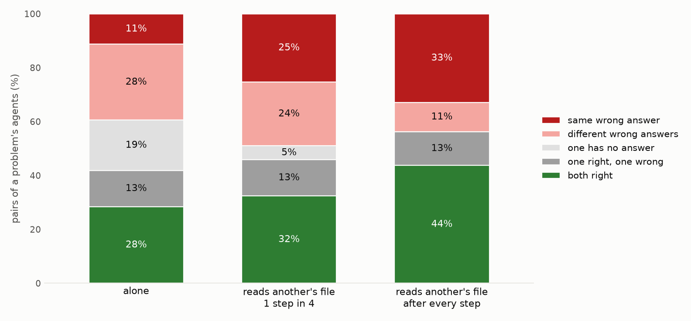

Figure: apex_shortlist / main, 25 problems, 8 agents a problem. Every pair of a problem's agents, by how the two ended, as a percent of the problem's pairs averaged over problems. Bars: alone (`desk`), reads another's file 1 step in 4 (`look_at_others`), reads another's file after every step (`always_look_at_others`). The numbers: `uv run lab show apex_shortlist/main`.
