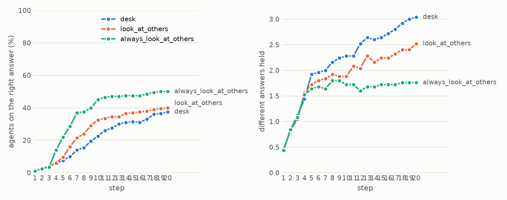

Figure: apex_shortlist / main, 25 problems. Left: share of agents holding the right answer after each of their steps (an agent that has stopped keeps its answer). Right: how many different answers a problem's agents held. Each point is a mean over problems. The numbers are in summary.md.
